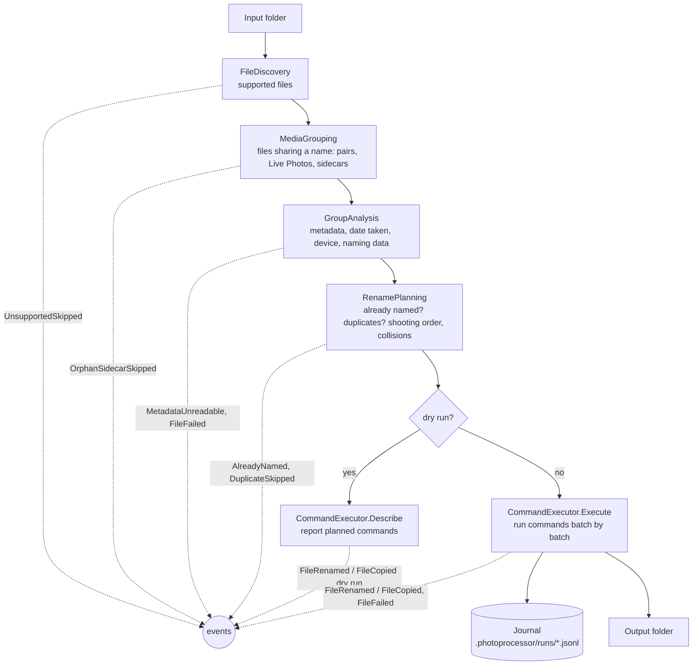
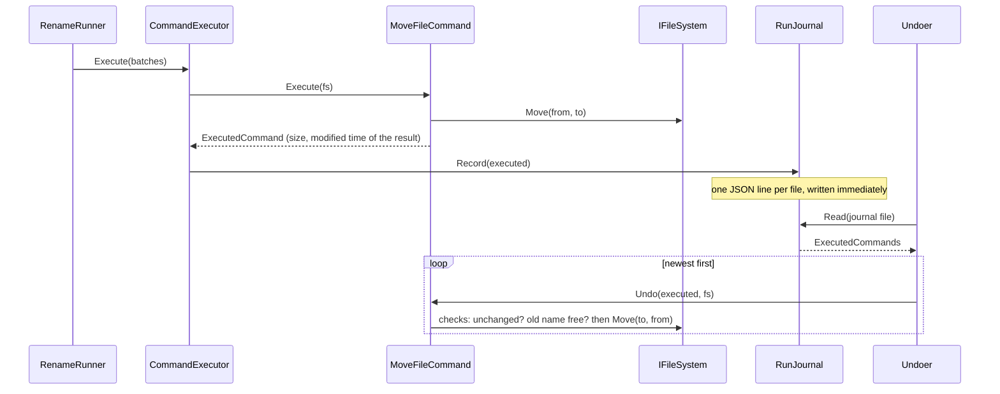
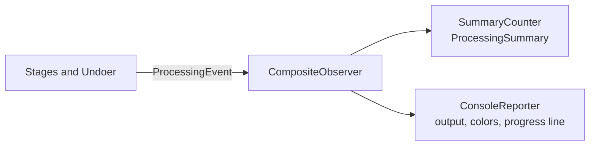
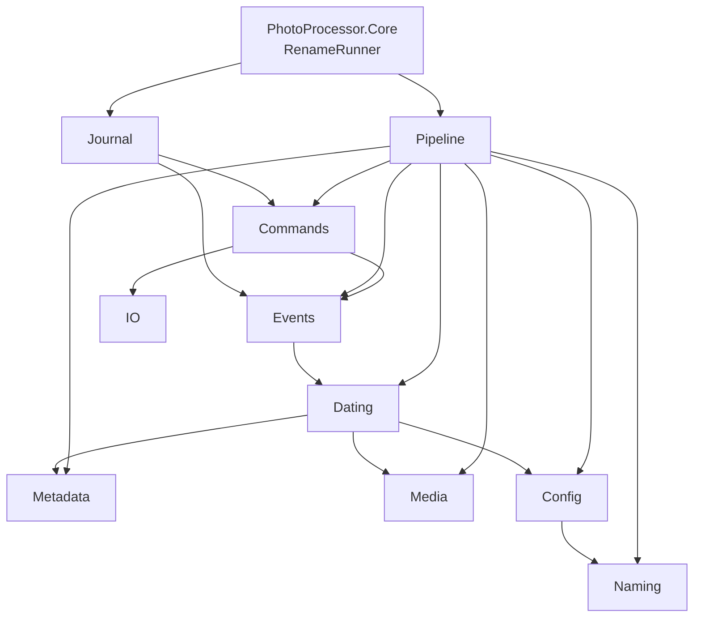

# PhotoProcessor

Photos and videos from different devices all use different file names (`IMG_20210408_194108.jpg`, `GOPR3564.JPG`, `PXL_20210408_194108123.jpg`, `20221113_135022.mp4`, …), so a folder that mixes them never sorts in the order things happened. PhotoProcessor renames them to one consistent, sortable scheme built from **when** each file was taken and **with which device**, read from the file's metadata.

```
IMG_20210408_194108.JPEG     ->  IMG 2021-04-08 19.41.08 Mi4c.jpg
IMG_20210408_203040.jpg      ->  IMG 2021-04-08 20.30.40 A41.jpg
IMG_20210408_203040(1).jpg   ->  IMG 2021-04-08 20.30.40 A41 1.jpg
GOPR3564.JPG                 ->  IMG 2021-12-01 21.30.00 Hero7.jpg
GH013592.MP4                 ->  VID 2021-12-01 21.45.00.mp4
IMG_1234.HEIC + IMG_1234.MOV ->  IMG 2024-06-01 10.00.00 iPhone 15.heic + .mov
DSC_0042.NEF  + DSC_0042.JPG ->  IMG 2022-11-13 13.50.22 NIKON Z 6.nef + .jpg
```

The name format is configurable, every run can be previewed first and undone afterwards, and files that already have their final name are left alone, so running it again on the same folder is safe.

## Contents

- [Features](#features)
- [Getting started](#getting-started)
- [Usage](#usage)
- [Configuration](#configuration)
- [How files are named](#how-files-are-named)
- [Undo and run history](#undo-and-run-history)
- [Architecture](#architecture)
- [Development](#development)

## Features

- **Date taken from metadata**: EXIF for photos, QuickTime/MP4 headers for videos, with time zone handling, falling back to dates embedded in file names and finally the file's modified time.
- **Device names**: the camera model from the metadata, shortened through a mapping you control (`SM-A415F` → `A41`).
- **Modern formats**: JPG, PNG, HEIC/HEIF, AVIF, WebP, TIFF, RAW (DNG, CR2, CR3, NEF, ARW, ORF, RW2, RAF, PEF, SRW, …), MP4, MOV, M4V, 3GP.
- **Pairs stay together**: RAW+JPEG pairs, Live Photos (HEIC+MOV) and sidecars (`.xmp`, `.aae`, `.thm`) get the same name.
- **Customizable names**: a template such as `{type} {date:yyyy-MM-dd HH.mm.ss}[ {device}][ {counter}]`.
- **Safe**: dry run, duplicate detection, never overwrites, re-runs change nothing, every run can be undone, Ctrl+C stops cleanly.

## Getting started

Requires the [.NET 9 SDK](https://dotnet.microsoft.com/download) or newer.

```bash
git clone https://github.com/panjajdak/photo-processor.git
cd photo-processor
dotnet publish src/PhotoProcessor.Console -c Release -o publish
```

This produces `publish/photoprocessor.exe` with `config.json` next to it. Edit the config (at least `DeviceMapping`, and `InputDirectory`/`OutputDirectory` if you want defaults), check it, and preview a run:

```bash
publish/photoprocessor config
publish/photoprocessor rename D:\Camera D:\Photos --dry-run
```

## Usage

```
photoprocessor <command> [arguments] [options]
```

| Command | What it does |
|---|---|
| `rename [input] [output]` | Rename the photos and videos in `input`, moving them to `output` (or renaming in place when `output` is omitted). Without arguments, uses `InputDirectory`/`OutputDirectory` from the config. |
| `undo [folder\|journal]` | Revert the latest run that wrote to a folder, or a specific run's journal file. |
| `history [folder]` | List the runs recorded in a folder and whether they were undone. |
| `config` | Show which config file is used, its settings with example names, and every problem in it. |

| Option | Applies to | Meaning |
|---|---|---|
| `-n`, `--dry-run` | `rename`, `undo` | Show what would happen without changing any file. |
| `--copy` | `rename` | Copy instead of move, leaving the input folder untouched. |
| `-c`, `--config <file>` | all | Use another config file. |
| `-v`, `--verbose` | all | List every file renamed, restored or skipped, with full error details. |
| `-q`, `--quiet` | all | Print only the summary and errors. |
| `-h`, `--help` | all | Help with examples for any command. |
| `--version` | – | Print the version. |

```bash
photoprocessor rename D:\Camera --dry-run        # preview, in place
photoprocessor rename D:\Camera D:\Photos        # rename and move
photoprocessor rename D:\Camera D:\Photos --copy # rename copies, keep originals
photoprocessor rename                            # folders from the config
photoprocessor undo D:\Photos                    # revert the last run into D:\Photos
photoprocessor history D:\Photos
```

Results go to stdout; warnings, errors and the progress line go to stderr (colored on a terminal unless `NO_COLOR` is set). Subfolders are not processed.

### Exit codes

| Code | Meaning |
|---|---|
| `0` | Success. |
| `1` | Finished, but some files failed (rename) or were skipped (undo). |
| `2` | Invalid arguments or configuration; nothing was changed. |
| `3` | An unexpected error stopped the run; files finished so far are in the journal. |
| `130` | Stopped with Ctrl+C; files finished so far are in the journal. |

## Configuration

The config file is found in this order: `--config <file>`, the `PHOTOPROCESSOR_CONFIG` environment variable, `config.json` next to the executable. Comments and trailing commas are allowed. `photoprocessor config` shows which file is used and validates it; an invalid config stops every command before any file is touched.

```jsonc
{
    "InputDirectory": "\\\\NAS\\photos\\in",       // default for "rename" without arguments
    "OutputDirectory": "\\\\NAS\\photos\\out",     // defaults to the input folder
    "FileNameTemplate": "{type} {date:yyyy-MM-dd HH.mm.ss}[ {device}][ {counter}]",
    "ImagePrefix": "IMG",                          // value of {type} for photos
    "VideoPrefix": "VID",                          // value of {type} for videos
    "TimeZone": "",                                // e.g. "Europe/Warsaw"; empty = system time zone
    "LocalTimeVideoPatterns": [                    // videos whose timestamps are already local time
        "^GOPR\\d{4}\\.",
        "^G[HXLP]\\d{6}\\."
    ],
    "Options": {
        "CopyingEnabled": false                    // same as --copy
    },
    "DeviceMapping": {                             // camera model (case-insensitive) -> name in file names
        "SM-A415F": "A41",
        "HERO7 Black": "Hero7"
    }
}
```

**DeviceMapping** keys are the model as the camera writes it into EXIF, which is often a model code rather than the marketing name (a Galaxy S23 writes e.g. `SM-S911B`). Unmapped models are used as they are; characters not allowed in file names are replaced by `_`.

**TimeZone** is used to convert video timestamps, which phones store in UTC, to the local time shown in the name. **LocalTimeVideoPatterns** lists file name patterns of cameras that store local time instead (GoPro does), so they are not converted.

### File name template

Text outside braces is copied as is, including spaces. Tokens in braces are replaced per file.

| Token | Value |
|---|---|
| `{type}` | `ImagePrefix` or `VideoPrefix` |
| `{date:FORMAT}` | Date taken in a [.NET date format](https://learn.microsoft.com/dotnet/standard/base-types/custom-date-and-time-format-strings), e.g. `{date:yyyyMMdd_HHmmss}` |
| `{device}` | Mapped device name (`A41`), or the raw model when unmapped |
| `{make}`, `{model}` | Raw camera make and model |
| `{original}` | Original file name without extension |
| `{counter:FORMAT}` | Number for files that would get the same name; empty for the first one, e.g. `{counter:000}` |
| `[ ... ]` | Optional section, left out when any token inside has no value |
| `{{` `}}` `[[` `]]` | Literal braces and brackets |

| Template | Result |
|---|---|
| `{type} {date:yyyy-MM-dd HH.mm.ss}[ {device}][ {counter}]` (default) | `IMG 2021-04-08 19.41.08 A41.jpg`, `IMG 2021-04-08 19.41.08 A41 1.jpg` |
| `{type}--{date:yyyy-MM-dd--HH-mm-ss}[--{device}][--{counter:000}]` | `IMG--2021-04-08--19-41-08--A41.jpg`, `IMG--2021-04-08--19-41-08--A41--001.jpg` |
| `{date:yyyyMMdd_HHmmss}[_{device}]` | `20210408_194108_A41.jpg` |
| `{date:yyyy-MM-dd HH.mm.ss} {original}` | `2021-04-08 19.41.08 IMG_1234.jpg` |

Templates are validated up front: unknown tokens, unbalanced brackets, date formats that produce characters not allowed in file names (such as `HH:mm`), a trailing space or dot, or `{counter}` sharing an optional section with other tokens are all reported. A template without `{counter}` gets ` {counter}` appended so collisions can always be resolved.

## How files are named

### Date taken

Each file's date comes from the most trustworthy source available:

| Photos | Videos |
|---|---|
| 1. EXIF `DateTimeOriginal` | 1. QuickTime creation date with UTC offset (iPhone), as local wall-clock time |
| 2. EXIF `DateTimeDigitized` | 2. Movie header creation time: UTC converted with `TimeZone`, or taken as is for `LocalTimeVideoPatterns` |
| 3. Date and time in the file name | 3. Date and time in the file name |
| 4. EXIF `DateTime` (last edit) | |
| 5. Date-only file name (`IMG-20210408-WA0001.jpg`): the file's modified time if it is on that day, else midnight | 4. Date-only file name, as for photos |
| 6. File modified time | 5. File modified time |

Recognized file names include `IMG_20210408_194108`, `PXL_20210408_194108123`, `Screenshot_20210408-194108`, `20221113_135022`, WhatsApp's `IMG-20210408-WA0001` and this tool's own output. Unreadable metadata is reported and the file is dated from the next source instead of failing.

### Groups

Files in the same folder that share a name are renamed together: `DSC_0042.NEF` + `DSC_0042.JPG`, `IMG_1234.HEIC` + `IMG_1234.MOV` + `IMG_1234.AAE`, and sidecars in both styles (`photo.xmp` and `photo.dng.xmp`). The member with the most trustworthy date names the group, so an unreadable RAW takes its date and device from its JPEG. A group containing any photo uses the photo prefix, so a Live Photo video sorts next to its photo. A sidecar without a matching photo or video is skipped.

### Collisions, duplicates and re-runs

- Groups that end up with the same name are numbered in shooting order (EXIF sub-seconds, then original name), and a whole group moves to the next number together, so pairs never split.
- A file byte-identical to one already in the output folder, under any name, or to one earlier in the same run, is reported as a duplicate and left where it is.
- When renaming in place, a group whose name already matches the template (with any counter) is left alone, so running twice changes nothing.
- Nothing is ever overwritten.

## Undo and run history

Every move or copy is appended to a journal in `<output>/.photoprocessor/runs/<yyyyMMdd-HHmmss-fff>.jsonl` (a hidden folder), one JSON line per file, written right after the file operation so an interrupted run can still be undone:

```json
{"op":"move","from":"D:\\Camera\\IMG_1234.HEIC","to":"D:\\Photos\\IMG 2024-06-01 10.00.00 iPhone 15.heic","size":2481733,"modifiedUtc":"2024-06-01T08:00:03Z"}
```

`undo` replays the latest journal that has not been undone, newest operation first:

- A moved file is moved back only if it is unchanged since the run (size and modified time) and nothing else has taken its old name.
- A copy is removed only while the original still exists with identical content.
- Anything that cannot be undone safely is skipped and listed; the run stays undoable, so `undo` can be repeated after fixing it. Once every entry is reverted the journal is renamed to `*.undone.jsonl`, and the next `undo` steps one run further back.

## Architecture

The solution has three projects:

| Project | Role |
|---|---|
| `PhotoProcessor.Core` | All logic: reading metadata, choosing dates and names, planning and executing file operations, journal and undo. No console code. |
| `PhotoProcessor.Console` | The `photoprocessor` command-line tool: argument parsing ([System.CommandLine](https://github.com/dotnet/command-line-api)), config loading, help, output formatting, exit codes, Ctrl+C. |
| `PhotoProcessor.Core.Tests` | xUnit tests: unit tests per component, pipeline stages on an in-memory file system, and end-to-end runs on generated JPEG/TIFF/WebP/MP4/MOV files. |

### Design

Core combines three patterns:

- **Pipeline**: renaming is a chain of small stages, each with one job. Every stage before the last only *decides*; only the last one changes files.
- **Command**: the plan is a list of `MoveFileCommand`/`CopyFileCommand` objects. Each command knows how to execute itself and how to undo itself safely. A dry run *describes* the planned commands instead of executing them, so it shows exactly what a real run would do. The journal is the list of executed commands, and undo replays it in reverse.
- **Observer**: stages report what happens as `ProcessingEvent`s instead of writing output or updating counters. The summary is counted from the events, and the console turns them into output, so new outputs (e.g. a JSON report) need no changes in Core.

File system access goes through the `IFileSystem` port and metadata reading through `IMetadataReader`, so stages can be tested in memory.

### Rename flow



| Stage | Input → output | Responsibility |
|---|---|---|
| `FileDiscovery` | folder → file paths | Keeps photos, videos and sidecars; reports the rest. |
| `MediaGrouping` | paths → `MediaGroup`s | Groups files by shared name (`MediaTypes.GetStem`); reports sidecars without a media file. |
| `GroupAnalysis` | `MediaGroup` → `AnalyzedGroup` | Reads metadata (`IMetadataReader`), resolves each file's date (`DateResolver`), picks the best-dated member, resolves the device (`DeviceNameResolver`) and builds the `NameContext` for the template. |
| `RenamePlanning` | `AnalyzedGroup`s → `CommandBatch`es | Leaves already-named groups alone, orders groups by shooting time, skips duplicates, finds the first counter where the whole group fits, and emits one batch of commands per group. Simulates the output folder with `OutputFolderState` so names planned earlier in the run count as taken. |
| `CommandExecutor` | `CommandBatch`es → files moved | Executes commands, records each in the journal, reports progress; on Ctrl+C stops between batches, so a group is never split. |

`RenameRunner` wires the stages together and is the public entry point.

### Commands, journal and undo



### Events



| Event | Meaning |
|---|---|
| `FileRenamed`, `FileCopied` | A file got its new name (`DryRun` set when only planned). |
| `AlreadyNamed`, `DuplicateSkipped` | A file was left alone because it already has its name, or an identical copy exists. |
| `UnsupportedSkipped`, `OrphanSidecarSkipped` | A file was ignored. |
| `MetadataUnreadable` | Metadata could not be read; the file is dated from its name or file time. |
| `FileFailed` | Files could not be processed. |
| `ProgressChanged` | Progress of the current stage. |
| `FileRestored`, `UndoSkipped` | Undo reverted an operation, or skipped it as unsafe. |

### Core namespaces

Arrows point to the namespaces a namespace uses. There are no cycles: `Naming`, `Metadata`, `Media` and `IO` depend on nothing else in Core.



| Namespace | Contents |
|---|---|
| `PhotoProcessor.Core` | `RenameRunner` (entry point), `ProcessingResult`, `ProcessingSummary` |
| `Config` | `Configuration`, `Options`, `ConfigurationCheck` (validation and example names), `InvalidConfigurationException` |
| `Pipeline` | The stages above, their data (`MediaGroup`, `AnalyzedGroup`, `GroupMember`) and `OutputFolderState` |
| `Commands` | `IFileCommand`, `MoveFileCommand`, `CopyFileCommand`, `ExecutedCommand`, `CommandBatch`, `CommandExecutor`, `ICommandLog`, undo outcomes |
| `Journal` | `RunJournal` (journal file format and location; implements `ICommandLog`), `Undoer`, `RunHistory` |
| `Events` | `ProcessingEvent` records, `IProcessingObserver`, `SummaryCounter`, `CompositeObserver` |
| `Dating` | `DateResolver` (source priority and time zones), `DateSource`, `FileNameDateParser` |
| `Naming` | `FileNameTemplate` (parse, render, recognize names), `NameContext`, `DeviceNameResolver` |
| `Metadata` | `IMetadataReader` and its [MetadataExtractor](https://github.com/drewnoakes/metadata-extractor-dotnet) implementation, `MediaMetadata` |
| `Media` | Supported extensions, media kinds, sidecars, shared-name (stem) rules |
| `IO` | `IFileSystem`, `PhysicalFileSystem`, `FileComparer` |

## Development

```bash
dotnet build src/PhotoProcessor.sln
dotnet test src/PhotoProcessor.sln
dotnet run --project src/PhotoProcessor.Console -- rename D:\Camera --dry-run
```

Tests generate their own minimal JPEG, TIFF/DNG, WebP, MP4 and MOV files and use temporary folders or the in-memory file system, so they need no sample photos.
